## 👋 Hi, I'm lemon

- Backend engineer, learner
- Java / Python
- 📚 Reading · 🎮 Gaming · 📷 Photography · ✈️ Travel

## 🖥️ Recently Activity

<!--RECENT_ACTIVITY:start-->
1. ❗ Opened issue [#2](https://github.com/wangrongding/tv-fresh/issues/2) in [wangrongding/tv-fresh](https://github.com/wangrongding/tv-fresh) 
2. ❗ Opened issue [#432](https://github.com/pengchujin/aerial-tv/issues/432) in [pengchujin/aerial-tv](https://github.com/pengchujin/aerial-tv) 
3. 💪 Opened PR [#6317](https://github.com/awesome-dsh-plugin/awesome-dsh-plugin/pull/6317) in [awesome-dsh-plugin/awesome-dsh-plugin](https://github.com/awesome-dsh-plugin/awesome-dsh-plugin) 
4. 🚀 Published release [dsh-mimo-tts 0.1.0](https://github.com/lengmodkx/dsh-mimo-tts/releases/tag/v0.1.0) in [lengmodkx/dsh-mimo-tts](https://github.com/lengmodkx/dsh-mimo-tts) 
<!--RECENT_ACTIVITY:end-->

## 🎮 Space Shooter Game

## 📊 GitHub Stats

